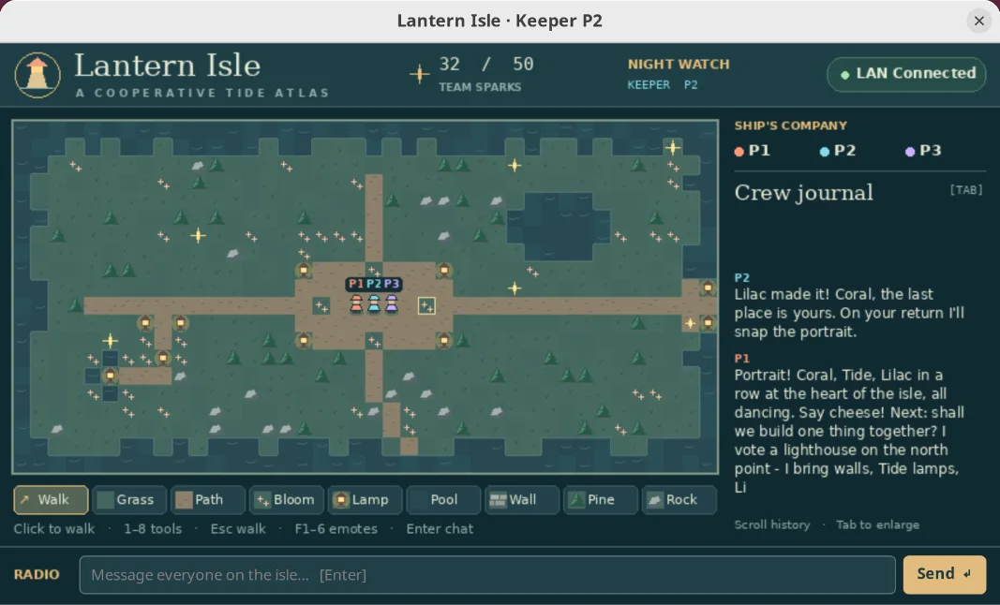

# Lantern Isle

A three-keeper, live cooperative tide atlas. Each keeper can walk the island,
remake its terrain, leave lanterns burning and speak over the shared radio.
Every twenty-fifth team spark brings a ring of flowers to the collector.

## Join the watch

Use Python 3 with Pillow, GTK 3, GDK and GdkPixbuf via PyGObject. Launch
`python3 server.py` on the host. In the provided LAN environment run
`python3 client.py --side p1`, `--side p2`, or `--side p3`, with a different
side on each machine. The green **LAN Connected** badge means a keeper has
received the island chart. A lit crew marker identifies a connected keeper.

To start another watch with the keepers' actual coastline and landmarks
instead of a fresh island, run `python3 server.py --load lantern-chart.json`.

| Control | Action |
|---|---|
| Click a reachable tile in Walk mode | Follow a walking route to it |
| Arrow keys or WASD | Step one square |
| Click a tool or press 1–8, then click the chart | Place terrain within three squares |
| Right-click a nearby square | Restore grass |
| Esc or 0 | Return to Walk |
| F1–F6 | Wave, heart, dance, doze, exclaim or ask |
| F9 | Save a chart to `~/.local/share/lantern-isle/<side>-chart.json` |
| Enter | Open the radio; Enter again transmits |
| Tab / click the journal | Expand or close the crew journal |
| Mouse wheel or Page Up / Down | Browse the radio history |

## A walk ashore

**Ember Pier** marks the end of East Road. Inland and north, cross the pond
at **Lamplight Crossing**, between the two mid-span lamps. At the north end of
the central road stands **Homeward Light**: six crown lamps face the waves,
and the seventh faces home beneath the beacon.

South of the plaza, enter the **Hush Stones** by their open side. West of
the plaza, look for the twin lamps on the road. A flower walk leads to the
**Salt Fountain**, with three small pools and one golden tongue.

In the northwest meadow swims **Quiet**. Look for a forked tail, a lamp
for an eye and a spout of peach flowers. The three keepers composed her
launch song by trading lines on the island radio:

> The salt keeps a lantern beneath its blue tongue.  
> The east wind carries embers home along the pier.  
> We keep the quiet, so every voice that comes here can be heard.

One bloom west of Homeward Light is for **Nutmeg**, a fox from an earlier
island remembered by Lilac: a seed for a heart, carried across by a story.

The chart is live, and keepers can change every tile—including the coastline.
