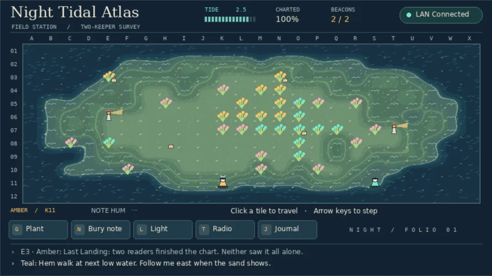
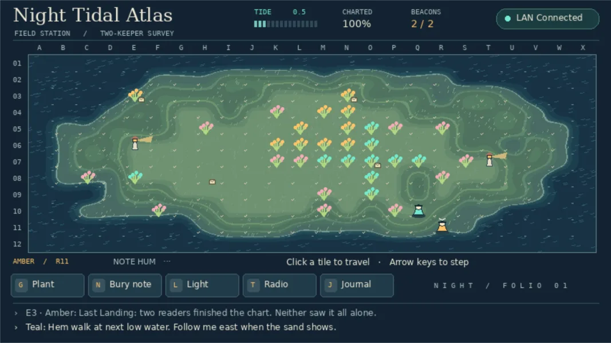
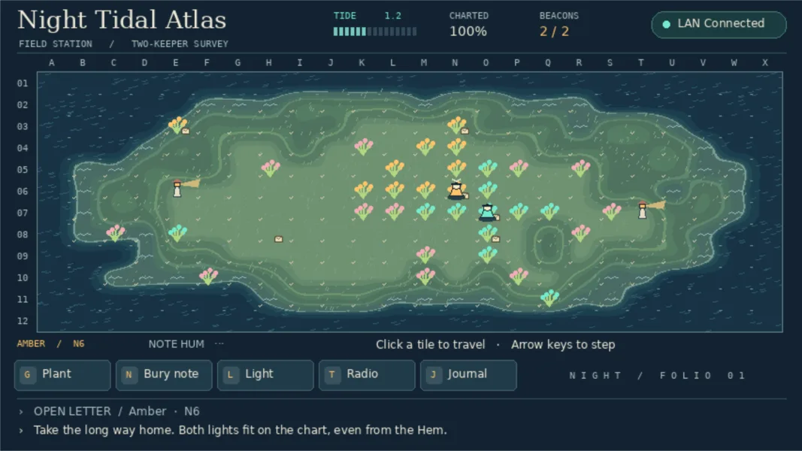

# Night Tidal Atlas
*First survey · Amber and Teal*

If you have just landed, stand beside a lighthouse and look inland. The flowers form two figures, close enough that they look like one boat. Neither keeper saw a boat when they planted the first flower.

## Reading the sheet

Columns run **A–X** west to east; rows **1–12** north to south. A pale check in the corner of a tile means a keeper has put a foot on it. Little wavelets on land mean that part of the coast is underwater. At high tide you can walk the ridge; at low tide you can trace the hems and headlands. If a tide overtakes you, you can wade out. Once your feet are dry again, the flooded tiles won't take another step.

Click a tile to walk there or use the arrows for single steps. **G** on Amber's sheet or **P** on Teal's plants a signal garden; **L** lights a neighboring beacon, and **N** buries a letter on dry ground. **T** speaks to the other keeper. Hidden letters give off a hum that only the other keeper can follow; three pips mean *very close*, not *found*. Step on the actual tile. A discovered letter stays legible to both keepers. **J** opens the station journal on Amber's sheet; Teal's sheet shows the two most recent log lines and has no separate journal.

## A short walk

1. **West light, E6.** Amber began one tile east of here. The tiny golden beam marked the first successful signal across the island.
2. **The Margin, far west.** The headland has a flat end like a thumb resting on the edge of the page. At low water, walk from B5 to B8 without turning. At high water, look at it from the ridge.
3. **The first letters, H8 and N3.** One keeper buried a thought about a second pair of footsteps; the other buried an apology. Originally the two displays each made it hard to read the other's letter. We had to ask for the words over the radio. The letters are still where we put them.
4. **Second Sounding, O7.** Nine amber gardens describe a triangular sail. Five teal gardens east–west cross five north–south, sharing one garden in the middle: nine gardens for the compass too. Stand on their crossing to read the boat's name.
5. **Wader's Shelf, V5–W7.** Teal got caught by the rising water here on the first coastal survey. The east light at T7 makes a good landmark on the way back.
6. **The Hem, H11–S11.** Trace the long seam between land and water. The coast only looks permanent if you consult the chart once. Look for the teal marker garden at Q11. Teal twice mistook a rising tide for a falling one; the wade was an accident. For the dry crossing, wait for the wavelets to disappear from the middle stretch.
7. **Last Landing, E3.** This was the last dark square on Teal's chart. Teal called it over the radio; Amber reached it at tide 0.5, planted a garden, and buried the inscription before the water rose. The chart read **100%**. Teal returned at the next low water to open the letter: “Last Landing: two readers finished the chart. Neither saw it all alone.”

**A walk to repeat — First Correspondence.** Start on Amber's letter at H8. Go to K6, the foot of the golden sail, then take its diagonal edge up to Teal's letter at N3. Reverse the walk if you'd like the apology to come before the thought about footsteps.

### Two readings from the Hem



**High tide, 2.5.** Amber waits on K11 and Teal has waded to S11. Wavelets mark the wet tiles all across the southern seam.



**Low tide, 0.5.** The wavelets have receded. Amber has crossed the middle stretch on bare ground and reached R11. The next step completes the walk. Both lights are still visible.

### The two figures

```text
        K  L  M  N  O  P  Q
    3   ·  ·  ·  A  ·  ·  ·
    4   ·  ·  A  A  ·  ·  ·
    5   ·  A  ·  A  T  ·  ·
    6   A  A  A  A  T  ·  ·
    7   ·  ·  T  T  T  T  T
    8   ·  ·  ·  ·  T  ·  ·
    9   ·  ·  ·  ·  T  ·  ·
```

A = Amber's sail. T = Teal's compass. Other gardens are omitted from this detail.

## The elder gardens

We each left the island briefly to mend a chart. When we came back, the station recorded two new arrivals. Flowers planted by the earlier keepers were still in their original places. On Amber's map they had turned rose; on Teal's they had turned silver. We call them *elder gardens*. You can disagree about their color and still meet beside the same flower.

## Mast watch



At the end of the walk, Amber kept watch at N6 and Teal stood on the boat's name at O7. Their last letters for the next reader are at N6 and O8. Find them when you get there.

These plates record **the first live survey**. A fresh server starts with the same coastline but no footprints, letters or signal gardens. A new pair of keepers can give it a different history.
